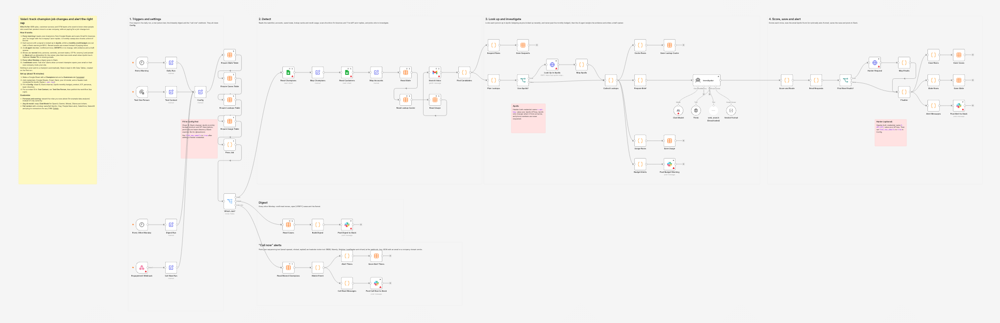

# Valari

**Know the moment a past user of your product changes jobs, and act on it before anyone else does.**

Valari is a free, open source alternative to paid job-change tools, built as n8n workflows. It watches your champions, catches the early signs that someone left (bounced emails, "no longer with the company" auto-replies), confirms the move with an AI agent, and then does the follow-up: finds their new work email, creates the contact in your CRM, adds them to the right sequence, and tells the right rep in Slack. When they open that email or their new company visits your site, the rep gets a **"call now"** alert.

Plug in your own tools. Bring any AI model.

> **Example:** Jordan ran your analytics rollout at Northwind. Her Northwind email bounces. Valari confirms she's now a Staff Data Analyst at Acme, where you have an open deal. It finds her new email, creates the contact and a task in Salesforce, adds her to your "job switchers: open deal" cadence, and pings Acme's account owner (cc'ing Jordan's old AE) with the evidence and a draft opener. Two days later she opens the email and the rep gets "Call now."

---

## Two ways to use it

| | **n8n template** (one workflow) | **Full version** (core + connectors) |
|---|---|---|
| Best for | Trying it in 15 minutes | Running it with your real stack |
| Tools | Google Sheets, Gmail, Apollo, Slack, optional Hunter | Any CRM, lookup, sequencing and alert tool through connectors (Salesforce, Apollo, Clay, Salesloft and more today) |
| CRM write-back and sequences | No | Yes |
| File | [`templates/valari-template.json`](templates/valari-template.json) | [`workflows/`](workflows/) |

Both share the same tested logic, prompts and data tables, so you can start with the template and move to the full version later without losing history.



---

## How it works

```
 CONNECTORS (plug in your tools)            CORE (the same for everyone)                          CONNECTORS
 ───────────────────────────────            ─────────────────────────────                         ──────────
 CRM watchlist + accounts  ──┐
 Product-user list         ──┤   1. DETECT       bounces, "I've left" replies, rechecks,
 Inbox signals             ──┘                   and a monthly sweep (1/3 of the list)
                                 2. LOOK UP      current job, tool by tool,          ◀── Lookup waterfall
                                                 within monthly credit budgets           (Apollo → Clay → PDL)
                                 3. INVESTIGATE  AI agent: confirmed / verify / no_change
                                                 + evidence + draft opener
                                 4. SCORE        role, persona, seniority, account,
                                                 ICP fit, recency, confidence
                                 5. ACT          new work email                      ──▶ Email finder
                                                 new contact + task                  ──▶ CRM
                                                 enroll (rep reviews first email)    ──▶ Sequence
                                                 alert the right rep                 ──▶ Slack / email
                                 6. CALL NOW     they opened, clicked, replied, or
                                                 their company visited your site     ──▶ Slack / email
```

**Three outcomes for every investigation:**

| Outcome | Meaning | What happens |
|---|---|---|
| **Confirmed** | A reliable source shows a new primary role at a different company | Scored alert with evidence, new email, CRM record, sequence status and draft opener |
| **[VERIFY]** | There's a signal (bounce, auto-reply) but no confirmed new role yet | A quick "please check LinkedIn" note to the owner. Rechecked automatically every 30 days |
| **No change** | Still at the old company | Logged quietly |

**What it never does:** send an email on its own, scrape LinkedIn, or touch anyone marked `do_not_contact`.

---

## Connectors

| Slot | Available now | Planned (help wanted) |
|---|---|---|
| CRM / watchlist | **Salesforce**, **Google Sheets** (also works as a product-user list) | HubSpot, Pipedrive, Attio, Close |
| Signals | **Gmail** | Outlook / Microsoft 365, IMAP |
| Lookup (waterfall of up to 3) | **Apollo**, **Clay**, **People Data Labs** | ZoomInfo, Crustdata, free web search (SearXNG) |
| New email | **Hunter** | Apollo, Prospeo |
| Sequence | **Salesloft** | Outreach, Apollo, HubSpot sequences |
| Alerts | **Slack**, **Gmail** | Microsoft Teams, Discord |
| Call now | Any tool that can send a webhook (sequencing tools, RB2B, Warmly, Snitcher, Leadfeeder, and so on) | |

Writing a connector means building one small workflow that follows the [connector contract](docs/connectors.md). The core doesn't change.

---

## What's in the repo

| Path | What it is |
|---|---|
| `workflows/core/` | **Daily Run**, **Digest**, **Call Now Webhook**, **MCP Server**, **Lookup Callback** |
| `workflows/connectors/` | One workflow per tool |
| `templates/` | The single-workflow n8n template and its submission text |
| `sheet/` | Template for the Google Sheets connector |
| `docs/` | [Setup](docs/setup.md) · [Configuration](docs/configuration.md) · [Connector contract](docs/connectors.md) |
| `src/` | The logic inside the Code nodes, as plain tested JavaScript |
| `prompts/` | The AI agent's instructions |
| `test/` | Unit tests (`npm test`) and end-to-end tests against a real n8n (`npm run test:n8n`) |

---

## Quick start

You need n8n 2.44 or later (self-hosted Community Edition is free), an AI model key, and accounts for the tools you plug in.

1. **Import** the core workflows and the connectors you need (n8n: **Workflows > Import from File**).
2. **Set up each connector**: add credentials and fill in its **Config**. Each one has a setup note on its canvas.
3. **Wire them up**: paste each connector's workflow ID into the **Config** node of the core workflows, then **publish** each connector. n8n only lets scheduled and webhook-started runs call published workflows.
4. **Describe your business** in the Daily Run **Config**: product, ICP, personas, team directory.
5. **Test** with **Execute workflow**, then publish **Daily Run**, **Digest**, **Call Now Webhook** and (if you use Clay) **Lookup Callback**.

The full walkthrough, using Salesforce, Salesloft, Gmail and Slack as the example stack, is in **[docs/setup.md](docs/setup.md)**.

---

## Lookup waterfall and credit guardrails

Valari tries up to three lookup tools in the order you choose and stops as soon as one finds the person's current job. A common setup:

1. **Apollo**, which most GTM teams already pay for. It only charges when it finds someone, and Valari never asks it for phone numbers.
2. **Clay**, only for people Apollo couldn't find. Clay runs its own waterfall across many data providers and sends the answer back to Valari's **Lookup Callback** a few minutes later.
3. **People Data Labs** as a cheap final fallback.

Guardrails so a run can't drain an account:

- **Monthly budget per tool.** A tool pauses when it hits its budget, and Valari moves on to the next one.
- **Slack warning at 80%** of any budget.
- **No paying twice.** Recent results are reused (14 days by default), and a tool that found nothing isn't asked about the same person again for 30 days.
- **A cap per run**, so one big sweep stays small.
- **Every result names its source**, so you can see what each credit bought.

## Persona scoring

Seniority isn't always what matters. If your best users are data analysts, an analyst moving to a new company is worth more to you than a VP who never logged in. Tell Valari who matters:

```json
[
  { "name": "Analyst", "keywords": ["data analyst", "analytics", "analyst"], "points": 25 },
  { "name": "Ops",     "keywords": ["revops", "operations", "ops"], "points": 20 }
]
```

Every weight is configurable. See [configuration](docs/configuration.md#scoring).

---

## Use it from Claude, ChatGPT, Cursor or any MCP client

The **MCP Server** workflow exposes `list_cases`, `list_tracked` and `investigate_contact`, so anyone on the team can ask *"Who changed jobs this month and which ones are Hot?"* or *"Look into Sam Okafor."*

---

## Costs

- **n8n:** free if self-hosted.
- **AI model:** one short call per person investigated. A small model (Claude Haiku, GPT mini models) keeps it cheap, and a local Ollama model is free.
- **Lookups:** you set a monthly credit budget per tool. Apollo is usually already paid for and only charges when it finds someone. Clay is asked only when Apollo finds nothing. Recent results are reused instead of paying twice. People Data Labs' free plan (100 a month) works as a cheap fallback.
- **Hunter, Salesloft, Salesforce, Slack:** whatever plan you already have.

---

## Responsible use

- Your data stays in your n8n instance and your own tools. Tracker state lives in n8n Data Tables.
- People send the emails. Sequences should start with a manual email step so a rep reviews every first message.
- No LinkedIn scraping. Lookups go through licensed data providers, and LinkedIn is only ever a link a person clicks.
- Honor opt-outs (`do_not_contact`) and the data rules that apply to you, such as GDPR for contacts in the EU.

---

## Roadmap

- More connectors (see the table above)
- The reverse signal: new hires at your customers who used your product before
- A "champion left a customer" churn-risk alert for account owners
- Scoring that learns from the `ae_feedback` column

Ideas and connector requests are welcome as [issues](../../issues).

## Contributing

See [CONTRIBUTING.md](CONTRIBUTING.md). New connectors are the easiest way to help.

## License

MIT. See [LICENSE](LICENSE). n8n itself is licensed separately under its Sustainable Use License.
